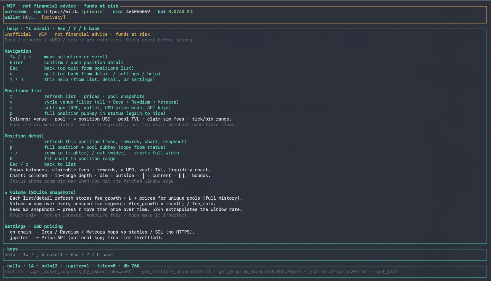
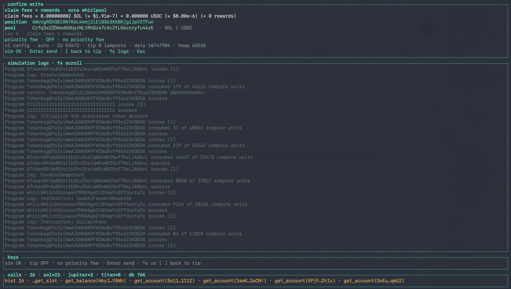
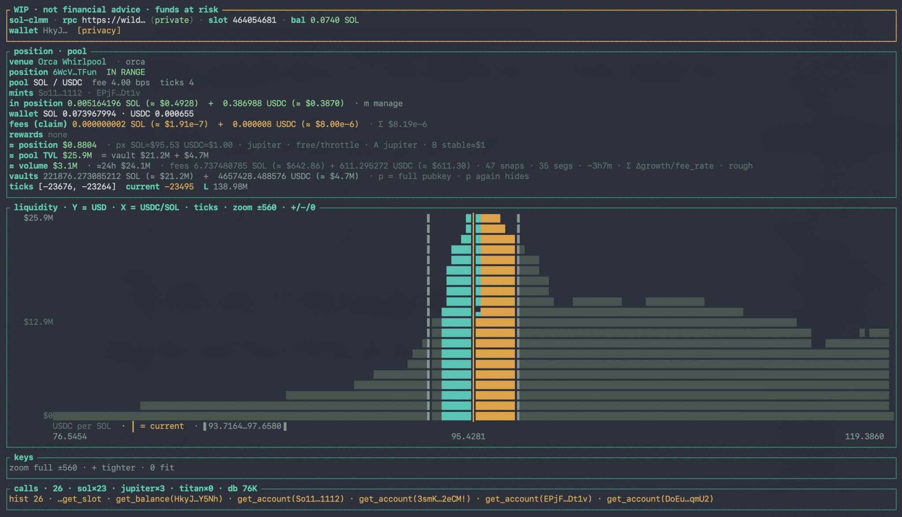

# sol-clmm-manager

> **Unofficial.** Not affiliated with, endorsed by, or related to Orca, Raydium, Meteora, or any exchange. Layouts and math are independently reimplemented from public on-chain data / docs — not vendor SDKs.
>
> **WIP — not production software.** Incomplete, experimental, and may be wrong about balances, fees, ticks, or transactions. Do not rely on it with funds you cannot afford to lose.
>
> **Financial risk.** DeFi / CLMM interaction can mean permanent loss of funds. You are solely responsible for any use. No warranty; authors are not liable for losses.
>
> **Review before use.** Read the source, build it yourself, verify on a throwaway wallet / RPC you trust.

---

# Writes: solid POC — not production size

**`--features write` is a working proof of concept.** Reads (list / detail / chart / ≈ USD) are solid. Claim / deposit / withdraw / close / create, native SOL wrap/unwrap, and tx v1 sim→send are in good shape for **dust / burner** testing across Orca · Raydium · Meteora.

| Area | Reality today |
|------|----------------|
| **Autoswap (Jupiter / Titan)** | **Does not work as intended yet.** Sizing, route, and slippage are unreliable. Prefer **no-swap** deposits (correct side in-range / out-of-range) until this is fixed. |
| **Everything else write-related** | Good as a POC — still use a **burner wallet**; always read sim logs before Enter send. |

Not audited. No warranty. Esc / cancel anytime. When in doubt: **read-only build, no `--features write`.**

---

Terminal + library workspace for **Solana concentrated liquidity**:

| Venue | Crate | Status |
|-------|--------|--------|
| **Orca Whirlpools** | `orca-whirlpool` | list / detail / chart / ≈ USD · writes POC |
| **Raydium CLMM** | `raydium-clmm` | list / detail / chart / ≈ USD · writes POC |
| **Meteora DLMM** | `meteora-dlmm` | list / detail / chart / ≈ USD · writes POC |

Built with Rust + [ratatui](https://ratatui.rs/). Shared domain lives in `sol-clmm-manager`; multi-venue reads go through `sol-clmm-client`; the interactive binary is `sol-clmm-tui`. Agent skills: [`skills/`](skills/).

## Why a TUI?

A terminal app is a deliberate alternative to a browser wallet / web dashboard:

- **Works when the website doesn’t** — venue frontends get geo-blocked, DNS-poisoned, Cloudflare/challenge-walled, or **DDoSed** during volatility. This stack talks **RPC + on-chain accounts** (and optional quote APIs you choose); no dependency on the exchange’s web UI staying up.
- **Your RPC under chain load** — when Solana is hot or a site’s shared RPC is rate-limited / lagging / 429’ing, swap to a **private or dedicated** endpoint in settings (Helius, Triton, self-hosted, etc.). Web UIs often hard-bind you to theirs; here the RPC is yours to choose.
- **Privacy & network footprint** — SSH to a VPS; local ISP mostly sees SSH, not DeFi page noise. Point RPC at an endpoint you control.
- **Less on the laptop** — small Rust binary + SQLite on a VPS / Pi / jump host.
- **Pubkey-only reads** — watch positions without a hot key on the viewing machine.
- **Scriptable / remote** — `ssh`, `tmux`, serial console.
- **Smaller browser attack surface** — you still must trust the binary, RPC, and (for writes) key handling.

**Writes are different.** When open/close/adjust land: keep keypairs off shared hosts, prefer hardware / remote signers, simulate before send.

## Workspace (5 crates)

```
sol-clmm-manager/          # this repo (Cargo workspace)
├── crates/
│   ├── sol-clmm-manager/  # shared domain: Rpc + meter, SQLite, tokens, quotes, math
│   ├── sol-clmm-client/   # thin Client API (agents + TUI)
│   ├── orca-whirlpool/    # Orca Whirlpools protocol lib
│   ├── raydium-clmm/      # Raydium CLMM protocol lib
│   ├── meteora-dlmm/      # Meteora DLMM protocol lib
│   └── sol-clmm-tui/      # TUI binary (ratatui)
├── skills/                # Cursor agent skills (sol-clmm · read · pricing)
├── docs/images/           # README screenshots
├── Cargo.toml
└── README.md
```

**Dependency direction**

```
sol-clmm-tui ──► sol-clmm-client ──► sol-clmm-manager
                     │           ├──── orca-whirlpool ──► manager
                     │           ├──── raydium-clmm   ──► manager
                     │           └──── meteora-dlmm   ──► manager
```

Protocol crates do **not** depend on the TUI. Agents should use **`sol-clmm-client::Client`** (same as the TUI). A future **agent** binary will sit on that Client (read default · write opt-in). Deferring `sol-clmm-core` / `sol-clmm-quotes` / agent bin until needed.

### Crate roles

| Crate | Type | Responsibility |
|-------|------|----------------|
| `sol-clmm-manager` | lib | RPC meter, SQLite, Jupiter/Titan quotes, **`Venue`**, fees/enrich/snapshots, **on-chain USD hops** (Orca + Raydium PDAs → Meteora LbPair) |
| `sol-clmm-client` | lib | **Agent/TUI API** — multi-venue `Client` (`list_positions` · `position_detail` · enrich) |
| `orca-whirlpool` | lib | Whirlpool decode, list, detail, amounts-from-L, chart series · rows tagged `Venue::OrcaWhirlpool` |
| `raydium-clmm` | lib | CLMM list/detail/amounts/chart/≈USD · NFT → PDA · `Venue::RaydiumClmm` |
| `meteora-dlmm` | lib | DLMM list/detail/amounts/chart/≈USD · PositionV2 GPA · `Venue::MeteoraDlmm` |
| `sol-clmm-tui` | bin | Interactive TUI — wizard, list, detail, settings, **`?` help**, refresh animation (calls `sol-clmm-client`) |

## Status

Pre-alpha. **Reads** (list / detail / chart / ≈ USD) work across Orca, Raydium, and Meteora (`v` filters). **Writes are a solid POC** (burner / dust) — see the note at the top; **autoswap** is the main gap.

## Progress

### Done

- [x] Cargo **workspace** · 5 crates (`solana-client =4.4.0`, tx v1–ready)
- [x] Shared manager lib (RPC meter · SQLite · tokens · Jupiter/Titan)
- [x] Orca Whirlpools lib (list · detail · DynamicTickArray · ≈ USD · symbols)
- [x] Raydium CLMM list / detail / amounts / chart / ≈ USD
- [x] Meteora DLMM list / detail / amounts / chart / ≈ USD
- [x] Ratatui TUI (`sol-clmm-tui`) — privacy trim, price modes, refresh load bar in-panel
- [x] Footer: session call counts (**sol / jupiter / titan**) + **SQLite DB size**
- [x] Position **venue** tag (`Orca Whirlpool` / `Raydium CLMM` / `Meteora DLMM`) on list + detail
- [x] Venue filter (`v`) across all three venues
- [x] MIT + unofficial / risk notes
- [x] **`sol-clmm-client`** multi-venue Client + `skills/` agent docs

### TODO

- [ ] List-row ≈ position USD + pool TVL (prefetch; detail reuses)
- [x] Claim-sim fees (fee-growth) + rewards · human amounts + USD
- [x] **Pool snapshots in SQLite** → period fee / volume deltas on detail refresh
- [x] Write scaffold (`--features write`) · **tx v1** · always simulate · auto CU/tip
- [x] **SOL as native** (not WSOL UX) · manage wrap/unwrap · Jupiter `wrapAndUnwrapSol` · DLMM strategies · close+claim · create
- [ ] Fill venue IX account metas (claim/deposit/withdraw/close/create send paths)
- [ ] **Agent mode** binary on the same libs (read default · write opt-in)
- [ ] Bundled positions · sharper chart markers

### Planned: agent mode

Separate binary on **`sol-clmm-manager` + protocol crates** (not a fork of decode logic).

| Mode | Default? | Capabilities |
|------|----------|--------------|
| **Read** | yes | list / detail / TVL / ≈ USD / quotes / meters |
| **Write** | off — `cargo run -p sol-clmm-tui --features write` | claim / deposit / withdraw / wrap·unwrap SOL / compound · **tx v1** · simulate always · consent prompt |

**Key material:** SQLite may store the **keypair file path** + pubkey. **Never** key bytes / seed. Keys are read from disk only at sign time.

### SOL (not WSOL)

Pools still use the WSOL mint on-chain (`So111…112`). The TUI treats that leg as **native SOL** end-to-end — no WSOL mode prompt.

| When | What |
|------|------|
| **Start** of deposit / create (SOL funded) | `wrap_sol_ixs` — native SOL → WSOL ATA |
| **Start** of claim / withdraw / close | `CreateIdempotent` pool ATAs (WSOL may be gone after a prior unwrap) |
| **Autoswap** | Jupiter/Titan **`wrapAndUnwrapSol=false`** — we wrap/unwrap ourselves |
| **End** of deposit / create / claim / withdraw / close | `unwrap_sol_ix` — close WSOL ATA → native SOL |
| **Manage → wrap SOL / unwrap SOL** | Same ixs, standalone |

Balances show **SOL** (native + any remaining wrapped). Claiming or withdrawing a SOL leg always unwraps.

**Wallet balance refresh (SOL pairs):** native SOL and the WSOL ATA change on every write. The TUI reloads wallet balances:

- on every **position detail** load / `r` refresh
- at the **start** of manage deposit / wrap (before mingling)
- **immediately after every landed tx** (fees + wrap/unwrap always move SOL)

### Pool report via on-chain snapshots (SQLite deltas)

Pools do **not** store rolling “24h volume”. We persist a snapshot on every **list/detail** refresh (unique pool), keep up to **64** points per pool, then sum **every consecutive segment** — not just last→current (two points alone are often too short / noisy).

**On each list/detail refresh (per pool pubkey), write something like:**

| Column | Source | Why |
|--------|--------|-----|
| `pool` | Whirlpool address | key |
| `slot` / `observed_at` | RPC clock | Δt |
| `fee_growth_global_a/b` | Whirlpool account (Q64.64) | LP fee growth; Δgrowth → period fee estimate |
| `protocol_fee_owed_a/b` | Whirlpool account | protocol cut sitting on the pool |
| `fee_rate` / `protocol_fee_rate` | Whirlpool account | convert growth / estimate volume |
| `liquidity` · `sqrt_price` · `tick` | Whirlpool account | context for growth→tokens |
| `vault_a` / `vault_b` | token vault accounts | TVL snapshot |
| optional `price_a/b_usd` | on-chain / Jupiter / Titan | USD report |

**How the chain helps**

- **Fees accrued (window)** ≈ Σ over segments `Δfee_growth × mean(L_i, L_{i+1})` (trapezoid L; wrapping Q64.64)
- **Volume (rough)** ≈ Σ `segment_fees_usd / fee_rate` — order-of-magnitude only; adaptive fees / multi-hop / uneven A·B make it imperfect
- **≈24h** = window volume × `86400 / dt` when the retained span has length
- **TVL / depth** from vault + price snapshots (already useful without growth)

**Where it lives:** `sol-clmm-manager` SQLite (same DB as settings/token cache) · protocol crates supply the decoded snapshot · TUI upserts on list/`r` and detail.

**Not a substitute for a swap indexer** when you need exact volume; good enough for a local “since first retained snap / across refreshes” pool report without HTTPS analytics.

## Stack

| Piece | Choice | Why |
|-------|--------|-----|
| Workspace | 5 crates | Protocols reusable without TUI; shared meter/store once |
| Solana | `solana-client =4.4.0` | Tx **v1** (SIMD-0385) |
| Whirlpools | Port in `orca-whirlpool` | No `orca_whirlpools*` (Orca License + `solana-* ^3`) |
| UI | `ratatui` | Terminal only in `sol-clmm-tui` |
| Config | SQLite | Wallet / RPC / keys / token cache · **planned pool snapshots** |

## Requirements

- Rust (edition 2024 / recent stable)
- Terminal with alternate screen + colors
- Solana RPC (private preferred)
- Wallet **pubkey** for read-only use

## How to run

```bash
git clone <this-repo>
cd whirpool-terminal   # or whatever you named the folder
cargo run -p sol-clmm-tui
```

```bash
# Read-only (default — no sign/send code linked)
cargo run -p sol-clmm-tui -- --pubkey <WALLET_PUBKEY>

# Writes: tx v1 + simulate + consent (path may be saved; secret never is)
cargo run -p sol-clmm-tui --features write -- --keypair ~/.config/solana/id.json

cargo run -p sol-clmm-tui -- --rpc-url https://your-private-rpc.example --pubkey <WALLET>
```

Release:

```bash
cargo build -p sol-clmm-tui --release
./target/release/sol-clmm-tui --pubkey <WALLET_PUBKEY>
```

Tests:

```bash
cargo test --workspace
```

### SQLite

Default: `~/.config/sol-clmm-manager/sol-clmm.db`  
Pointer: `~/.config/sol-clmm-manager/active_db`

Stores today: wallet / RPC / settings / token symbol·decimals cache · **pool_snapshots**.  
Footer shows on-disk **DB size** next to the RPC call meter.  
List/detail refresh writes fee-growth snapshots and shows ≈ volume summed across the retained chain — see [Pool report](#pool-report-via-on-chain-snapshots-sqlite-deltas).

If you still have an old `~/.config/whirpool-terminal/whirpool.db`, pass `--db` to reuse it.

### CLI flags

| Flag | Env | Meaning |
|------|-----|---------|
| `--rpc-url` | `RPC_URL` | HTTP RPC (default public mainnet) |
| `--pubkey` | `PUBKEY` | Wallet (read-only) |
| `--keypair` | `KEYPAIR` | JSON keypair **path** (path may be saved in SQLite; never key bytes) |
| `--db` | `SOL_CLMM_DB` | SQLite path |
| | `JUPITER_API_KEY` / `TITAN_API_KEY` | optional quote keys |

### Screens & keys

Press **`?`** or **`h`** in the TUI for the full in-app help (scroll with ↑↓ / j k).



| Screen | Keys |
|--------|------|
| **Help** | `?` / `h` open · ↑↓ scroll · Esc / `?` / `h` back |
| **Positions** | ↑↓ · Enter detail · **`v` venue filter** · `r` refresh (snapshots) · `s` settings · `p` Solscan · `q` |
| **Detail** | `r` refresh · `p` Solscan · **`+/-` zoom** · **`0` fit range** · **`m` manage** (writes) · Esc |
| **Create** (`n`, writes) | venue → pool → **range chart** → side/amount → review |
| **Create · range** | ←→ nudge · Tab focus · `H`/`L` shift · `1`/`2`/`3` ±5/10/25% · **`+/-` zoom** · **`0` fit** |
| **Manage** (`--features write`) | deposit · **wrap SOL** · **unwrap SOL** · close / claim / withdraw |
| **Write confirm** | ↑↓ tip · Enter sim · Enter send · `[` back · logs scroll |
| **Settings** | USD mode · API keys · privacy · RPC / wallet |



> Solid **POC** UI — still use a burner wallet. **Autoswap** is the known gap (prefer no-swap).

List merges Orca + Raydium + Meteora; **`v`** filters. Fees on the list are **claim-sim** (not stale owed). Volume needs **≥2** refreshes so SQLite can sum the snapshot chain.

**Liquidity chart** (Orca / Raydium / Meteora): opens **zoomed out** to the full fetched window (±512 ticks or bins). **`+`** tightens · **`-`** widens · **`0`** fits the draft/position range. Create also shows **`mix · ~% A / ~% B`** (deposit value split — not spot FX).



**Deposit / create swap rules:** out-of-range **correct** token → no autoswap; **wrong** token → full swap into the needed side; in-range 1-side → proportional ratio swap.

## Library reuse (agent path)

Prefer **`sol-clmm-client`** so you do not re-copy multi-venue wiring. Cursor skills: [`skills/sol-clmm`](skills/sol-clmm/SKILL.md), [`skills/sol-clmm-read`](skills/sol-clmm-read/SKILL.md), [`skills/sol-clmm-pricing`](skills/sol-clmm-pricing/SKILL.md).

```rust
use sol_clmm_client::Client;
use sol_clmm_manager::rpc::{connect, Rpc, RpcMeter};
use sol_clmm_manager::{PriceApiKeys, PriceMode, VenueFilter};

let meter = RpcMeter::default();
let sol = connect(rpc_url);
let rpc = Rpc::new(&sol, &meter);
let api = Client::new(PriceMode::OnChain, PriceApiKeys::default());
let rows = api.list_positions(&rpc, &wallet, Some(&store), VenueFilter::All, false)?;
let detail = api.position_detail(&rpc, &rows[0], Some(&store), false, Some(&wallet))?;
```

## Safety

1. Read `crates/` yourself — do not trust third-party binaries  
2. `cargo test --workspace` from this tree  
3. Start read-only with `--pubkey`  
4. Cross-check one position against another explorer  
5. Trust your RPC; only add a keypair when write paths exist and you understand them  

## Support

Optional SOL / SPL tips:

```
6qDHSiqcvTSNStNueDyqzxXBkWG5SVEzYd3JzGQDbfVb
```

No obligation. Tips do not buy SLAs, features, or liability — but they can help with continued improvement.

## License

**MIT** — see [`LICENSE`](LICENSE).

Covers **this repository only**. Does not grant rights to Orca / Raydium / Meteora trademarks or third-party code under other licenses.
